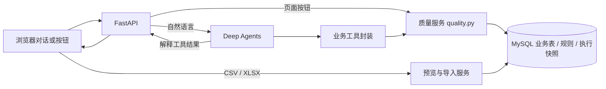

# 设计说明

## 调用链

Deep Agents 的 `create_deep_agent` 接收 `ChatOpenAI` 和七个业务工具。模型负责从中文请求判断目标、补全对话上下文、按需依次调用创建、运行、查询工具，并解释结构化结果。工具统一捕获业务异常并返回 `ok=false`；执行记录为 `FAILED` 时，即使工具调用返回数据也作为错误状态展示。Agent 不获得任意 SQL 工具；`quality.py` 使用白名单和参数化查询。页面按钮直接调用同一服务，避免双重口径。

## 本机启动与配置

`start.sh` 是单击启动入口：已有虚拟环境则复用，缺依赖时安装，然后交给 `app/launcher.py` 在 `127.0.0.1` 启动 Uvicorn 并打开 `/setup`。配置页通过 `app/settings.py` 这一模块保存模型和数据库配置：小接口是“读取脱敏配置、保存所选字段、检测连接、初始化演示库”，内部负责字段校验、`.env` 原子替换与 `0600` 权限。空密钥输入保持旧值。FastAPI 的配置路由只接受本机请求并检查同源 Origin；页面不读取已保存的密钥。`app/db.py` 和 `app/agent.py` 在下一次请求读取更新后的环境变量，所以无需重启。

“初始化演示库”执行项目自带 `schema.sql`；只有 `demo_orders` 为空时才执行 `seed.sql`。保存设置不触发初始化，已有业务数据和运行快照不被重置。此配置入口适合单人本机演示；多人部署应换成服务端密钥管理与身份认证。

同一浏览器会话使用固定 `session_id`。内存 `MemorySaver` 保存当前进程的模型消息；MySQL `chat_messages` 保存页面对话和工具轨迹。每个请求先写入用户消息，完成工具调用后即更新进度，最后写入回答或中断说明。最近一次创建或运行任务由用户消息中的工具轨迹归组；对“刚才的结果”追问会预取该任务的全部执行快照。重启后从 MySQL 恢复对话文字与最近对象引用。复杂长期记忆尚未做压缩或语义检索；进度记录与业务操作分两次提交，进程在两次提交之间崩溃时仍需人工核查。

## 数据与一致性

- `quality_rules` 保存规则配置。创建前查询 `information_schema` 校验表和字段，再验证规则类型及允许值。
- `data_imports` 保存文件哈希和元数据；`uploaded_orders` 以 `(dataset_id, order_id)` 为主键保存订单。文件结构全部验证后，在一个事务中保存元数据与明细；重复文件由唯一约束返回已有数据集。上传规则在 `quality_rules.dataset_id` 固定目标，两个校验查询都按此 ID 过滤。
- `quality_runs` 每次运行新增一行，记录规则 JSON 快照、时间、状态、五类计数、通过率、最多 20 条异常样例及错误。历史查询只读此表，不回查当前业务表。
- `chat_messages` 保存会话的原文和可展开的工具轨迹；固定验收数据保存在 `demo_orders`，Faker 批量数据保存在独立的 `demo_orders_faker`，空表与全跳过场景使用另外两张演示表。

运行时先创建 `RUNNING` 记录，再在 InnoDB `REPEATABLE READ` 一致性快照内分别执行全量聚合和异常样例查询，最后在同一事务更新执行结果。这样计数与样例取自同一版订单数据。校验查询抛错时尝试写入 `FAILED` 和错误信息。完全失去数据库连接时只能向页面返回 503。

非空规则的失败条件为 `IS NULL OR TRIM(column) = ''`。值域规则的 `NULL` 跳过；其他值以 `CAST(... AS BINARY)` 与允许值逐字节比较，规避默认不区分大小写及尾随空格的排序规则。全量聚合决定计数，`LIMIT 20` 仅控制保存的样例。总数 = 参与 + 跳过；参与 = 通过 + 不通过；参与为 0 时通过率为 `NULL`/`N/A`。

## 取舍

限定演示表和字符串字段，让模型只负责意图与编排，SQL 标识符由服务验证后组装，值由参数绑定。20 条基准数据与独立的万级模拟订单都使用同步执行；万级数据已经在本机运行，百万级和并发负载尚未测试。预留 `RUNNING` 和 `FAILED` 状态，便于以后扩展队列与中断恢复。

上传入口限制每个应用进程同时处理两个文件，并在读取 multipart 前限制请求体大小；规则扫描目前没有全站并发限额。老数据库由本机配置页用管理员连接执行幂等升级，普通应用账号可以只保留数据读写权限。详细接口、文件约束与代码片段见 [DATA_INGESTION.md](DATA_INGESTION.md)。
