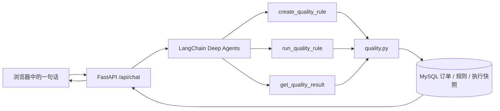

# 数据质量 Agent：先看技术，再听故事

## 一张流程图

## 技术上到底发生了什么

1. **一句话变成操作计划。** 浏览器把中文请求和 `session_id` 发给 FastAPI。`app/agent.py` 用 `ChatOpenAI` 创建支持工具调用的模型，再交给 `create_deep_agent`。模型识别“客户名称非空”和“状态值域”是两条不同规则，调用业务工具，而不是自己编造统计。
2. **规则落库。** `create_quality_rule` 进入 `app/quality.py`，检查白名单中的表、字段和规则参数，再把规则写入 `quality_rules`。值域规则没有允许值时必须追问。
3. **每次运行留下一份证据。** `run_quality_rule` 读取规则、执行 MySQL 聚合和异常样例查询，把规则快照、计数、样例和执行 ID 写入 `quality_runs`。非空规则把 `NULL`、空串、纯空格判为异常；值域规则跳过 `NULL`，其余值按字节精确比较。
4. **继续追问查旧账。** “刚才有哪些异常”依靠同一 `session_id` 找到最近执行 ID，`get_quality_result` 只读 `quality_runs` 中已保存的快照。业务表后续变化，只会影响新执行，不会改写旧统计和旧样例。
5. **可视化启动。** `start.sh` 准备 Python 环境，`app/launcher.py` 启动本机 Web 服务并打开 `/setup`。`app/settings.py` 将模型密钥和数据库密码保存到本机 `.env`；页面只显示已配置状态。配置写入后下一次请求就会生效。

基准 20 条订单的验收结果：客户名称规则失败 3 条（ID 1、2、3，值分别为 `NULL`、空字符串、三个空格）；状态规则失败 2 条（ID 4、5，值为 `UNKNOWN`、`REFUNDED`），另有 1 条 `NULL` 跳过。通过率分别是 `17/20=85.00%` 与 `17/19=89.47%`。

## 像给小朋友讲故事

想象有一家小商店，每天收到一叠订单卡片。店长请来一个会听懂话的“小助手”，说：“每张卡片都要写客户名字；状态只能写 NEW、PAID 或 CANCELLED。”

小助手先把这句话拆成**两张检查清单**，放进抽屉里。第一张看名字有没有空着，第二张看状态是不是三个允许词之一。接着，它请一位只会认真数数的“检查员”去看 20 张订单卡片。检查员找到 3 张没写好名字的卡片、2 张状态写错的卡片，并记下卡片编号和原样的错误内容。小助手把检查员写的记录展示给店长。

店长又问：“刚才有哪些异常？”小助手会翻开**刚才那次检查的记录本**，不会重新去看已经可能被改过的卡片。哪怕后来商店又多了一张坏卡片，再检查会有新的一页记录；旧的一页仍是原来的 3 条和 2 条。这就是“历史快照”。

浏览器是店长说话和看结果的窗口；大模型是听懂话、安排工作的助手；`quality.py` 是按规定检查的检查员；MySQL 是放订单、清单和记录本的柜子。密钥像打开模型服务的钥匙，只放在这台电脑的配置文件里，网页不会把旧钥匙显示出来。

## 下一步值得讨论的架构问题

- **单机还是多人使用？** 当前只有本机配置和一个数据库，没有登录或租户隔离。多人使用需要身份认证、权限分组和服务端密钥管理。
- **同步检查能跑多大？** 当前 20 条和万级演示数据直接同步运行。更大数据量应评估队列、任务状态、索引和分批策略。
- **“刚才”如何长期可靠？** 当前用会话 ID、MySQL 最近执行记录和进程内 checkpoint。多进程或长期会话应考虑持久化 checkpoint 与更明确的对象引用。
