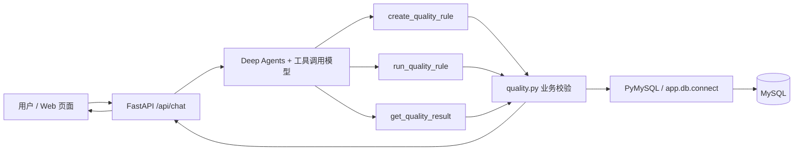

# 问题三：自然语言配置数据质量规则的原理与复现

## 1. 要解决什么问题

用户说“给模拟订单表的订单状态加值域规则，只允许 NEW、PAID、CANCELLED，创建后运行”。系统需要识别表、字段、规则类型和允许值，保存规则，扫描真实 MySQL 数据，持久化执行结果，再用自然语言解释统计和异常订单。用户只说“配置值域规则”而没有给允许值时，Agent 必须追问。

本项目的自然语言入口是 `POST /api/chat`。手动按钮和 Agent 共用 `app/quality.py`，因此两条入口的校验口径相同。网页只是调用 FastAPI，不直接连接数据库。



## 2. Agent 与数据库各做什么

1. **理解意图。** `app/agent.py` 用 `create_deep_agent` 接入支持工具调用的模型。提示词给出“订单表”“模拟订单表”等别名，并规定缺失允许值时追问。模型选择工具并填入结构化参数，不生成任意 SQL。
2. **创建规则。** `create_quality_rule` 调用 `quality.create_rule`。服务先检查规则类型、参数、表和字段，再查询 `information_schema` 确认目标存在；只接受演示表白名单和字符串字段。有效配置写入 `quality_rules`，返回规则 ID。
3. **执行规则。** `run_quality_rule` 根据规则 ID 读取已保存配置。`quality.run_rule` 新增独立的 `quality_runs` 记录，在 MySQL 一致性快照内做全表聚合和最多 20 条异常样例查询，并保存统计、规则快照、样例和状态。模型只接收统计与样例，不接收整张表。
4. **解释与追问。** `get_quality_result` 按执行 ID 或规则 ID 读取保存的执行记录。对“刚才的结果”等追问，后端会预取本会话最近一次执行快照并记录工具轨迹，Agent 再组织回答；创建或运行新规则时不做这一步预取。历史结果来自 `quality_runs`，不会用后来变化的订单数据重算旧样例。

规则口径：非空规则把 `NULL`、空字符串、纯空格判为失败；值域规则跳过 `NULL`，其余值与允许值按字节精确比较，`new` 和 `PAID ` 不等于 `NEW` 和 `PAID`。总数 = 参与 + 跳过；参与 = 通过 + 失败；通过率 = 通过 / 参与，参与为 0 时返回 `null`，页面显示 `N/A`。`SUCCEEDED` 表示程序执行完成，即使发现异常也仍是执行成功。

## 3. 接入后端数据的接口

数据库连接入口是 `app/db.py::connect()`，从 `.env` 读取 `MYSQL_HOST`、`MYSQL_PORT`、`MYSQL_USER`、`MYSQL_PASSWORD`、`MYSQL_DATABASE`，使用 PyMySQL 连接 MySQL。管理员执行 `sql/schema.sql` 建表；应用账号只需对业务表和规则表具有读写权限。当前实现只允许 `demo_orders`、`demo_empty_orders`、`demo_null_orders`、`demo_orders_faker`，接入新业务表需先确认表结构并扩展 `quality.SUPPORTED_TABLES` 及字段别名。数据库密码只保存在本机 `.env`，不要放进请求或报告。

| 接口 | 用途 | 主要输入 / 输出 |
| --- | --- | --- |
| `GET /api/health` | 检查数据库与模型配置 | `database`、`model_configured` |
| `GET /api/schema` | 读取可用演示表的真实列信息 | 表名、字段名、数据类型、可空性 |
| `POST /api/chat` | 自然语言配置、运行、追问 | `session_id`、`message` → `reply`、`traces` |
| `GET /api/rules` | 查看已保存规则 | 规则 ID、表、字段、类型、参数 |
| `POST /api/rules` | 页面或其他后端按结构化参数建规则 | 规则配置 → 规则 ID |
| `POST /api/rules/{rule_id}/run` | 运行已保存规则 | 执行 ID、状态、统计、样例 |
| `GET /api/results/{execution_id}` | 查询不可变的历史执行快照 | 规则快照、计数、样例、错误信息 |
| `GET /api/rules/{rule_id}/latest` | 查询某规则最近一次执行 | 同上 |

自然语言请求示例：

```bash
curl -sS -X POST http://127.0.0.1:8000/api/chat \
  -H 'Content-Type: application/json' \
  -d '{"session_id":"question-3-demo","message":"给模拟订单表的订单状态创建值域规则，只允许 NEW、PAID、CANCELLED，创建后运行并告诉我异常订单"}'
```

返回的 `traces` 列出实际工具名称、状态和结果摘要；`reply` 是 Agent 对真实结果的解释。无模型时仍可用结构化接口，例如：

```bash
curl -sS -X POST http://127.0.0.1:8000/api/rules \
  -H 'Content-Type: application/json' \
  -d '{"name":"订单状态值域","table_name":"demo_orders","column_name":"order_status","rule_type":"ENUM","params":{"allowed_values":["NEW","PAID","CANCELLED"]}}'
```

随后将返回的 `rule_id` 放入 `POST /api/rules/{rule_id}/run`，再以返回的 `execution_id` 调用 `GET /api/results/{execution_id}`。接口文档可在服务启动后打开 `/docs` 查看。

## 4. 从零复现

在项目目录运行，先通过配置脚本填写客户自己的模型 API Key，再在 `.env` 填写本机 MySQL 应用账号；不要提交或交付 `.env`：

```bash
unzip data-quality-agent.zip
cd data-quality-agent
python3 -m venv .venv
.venv/bin/python -m pip install -r requirements.txt
bash scripts/setup_model.sh
# 此时在 .env 中填好客户自己的 MySQL 应用账号，再继续
mysql -u root -p < sql/schema.sql
mysql -u root -p < sql/seed.sql
.venv/bin/python -m pytest -q tests/test_generator.py tests/test_acceptance.py
.venv/bin/python -m scripts.generate_orders --rows 10000 --seed 20261016 --write --verify
.venv/bin/uvicorn app.main:app --host 127.0.0.1 --port 8000
```

脚本会从 `.env.example` 创建仅当前用户可读写的 `.env`，隐藏输入 API Key，不会自动请求模型；客户自行编辑数据库配置。若尚无应用账号，先修改 `sql/create_user.sql` 的示例密码，再由管理员执行 `mysql -u root -p < sql/create_user.sql`。`sql/seed.sql` 会重置三张基准演示业务表，已有规则和历史快照仍保留。若 `demo_orders_faker` 的 ID 1–10000 已存在，**不要再次加 `--write`**，改用 `--verify` 只读核对。若本机 pip 镜像找不到 Faker 40.39.0，安装时加 `--index-url https://pypi.org/simple`。本机的 `ALL_PROXY=socks://...` 会使模型客户端报代理协议错误；本机启动服务时可用 `env -u ALL_PROXY -u all_proxy .venv/bin/uvicorn app.main:app --host 127.0.0.1 --port 8000`，保留已有的 HTTP(S) 代理。

浏览器打开 `http://127.0.0.1:8000`，输入第一节的请求；再输入“刚才的结果怎么样，有哪些异常订单？”。页面应展示规则和执行 ID、工具轨迹、统计及最多 20 条异常样例。也可调用上节的 HTTP 接口复现。

## 5. 本机实测记录（2026-10-16）

环境：Python 3.14.7、MySQL 8.4.11、Faker 40.39.0。`tests/test_generator.py` 与 `tests/test_acceptance.py` 合计 **6 项通过**。20 条基准订单仍保留：客户名非空结果为 20/20/17/3/0、85.00%；状态值域结果为 20/19/17/2/1、89.47%（顺序为总数/参与/通过/失败/跳过）。

固定种子生成并写入 `demo_orders_faker` **10,000 条**，生成器 `--verify` 与 MySQL 全量聚合一致。真实规则执行得到：

| 规则 | 总数 | 参与 | 通过 | 失败 | 跳过 | 通过率 | 保存样例 |
| --- | ---: | ---: | ---: | ---: | ---: | ---: | ---: |
| 客户名非空 | 10000 | 10000 | 9716 | 284 | 0 | 97.16% | 20 |
| 状态值域 | 10000 | 9907 | 9711 | 196 | 93 | 98.02% | 20 |

真实模型请求对新表依次调用了创建、执行和结果工具；同会话追问以及跨进程追问均能从保存快照取回结果。`POST /api/chat`、`GET /api/schema`、`GET /api/rules/{id}/latest`、`GET /api/results/{id}` 均返回 200。网页基准流程的截图与轨迹见 [页面测试报告](evidence/HERMES_TEST/测试报告.md)；大批量数据的验证为本轮后端和 HTTP 接口实测，尚未另做浏览器截图。MySQL 完全断线的 UI 场景仍未实测；代码会返回数据库错误，不能据此声称该场景已通过。
